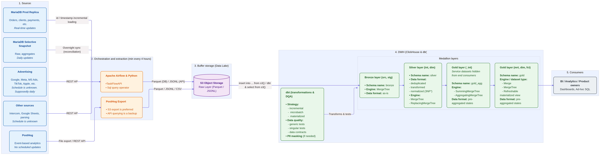

# 1. Discovery & Clarifying Questions for Business Stakeholders
##### 1. Data Freshness, SLAs & Business Criticality
* **Tiered Latency Requirements:** Do all 169 MariaDB tables actually require a 4-hour sync cadence? Separating tables into priority tiers (e.g., core product events every 4 hours vs. static lookup dimensions once a day) can significantly reduce replica load and compute costs.
* **Real-Time vs. Micro-Batch Needs:** Are there any operational dashboards, alerting triggers, or customer-facing features that require sub-minute/near-real-time latency (which would justify a Phase 1 CDC/Kafka setup), or is a 4-hour batch SLA sufficient for all current analytical use cases?

##### 2. Historical Depth, Updates & Data Retention
* **SCD2 Scope:** For mutable tables lacking an `updated_at` column (such as `usr_01` at 13.1 GB or `mkt_01` at 18.2 GB), does the business need to track full historical state transitions over time, or is only the latest operational state needed?

* **Retention & Archival Policy:** What is the analytical lookback window required in ClickHouse hot storage (e.g., 1–2 years for `prd_03` / `prd_05`), and after what period can older partitions be archived exclusively to cold S3 storage to optimize NVMe/SSD costs?

##### 3. Source Ownership & Schema Evolution
* **Upstream Schema Changes & updated_at Feasibility:** Can backend engineers add an indexed `updated_at` trigger/column to the largest mutable tables (`mkt_01`, `usr_01`), or enable MariaDB binary logging (`binlog_format=ROW`) for future CDC? If not, what is the maximum expected retroactive update window (e.g., do records ever get modified more than 7–14 days after creation)?

* **Table Scope & Deprecation:** Out of the 169 MariaDB tables, how many are actively needed for business KPIs versus legacy/deprecated tables that can be excluded from initial ingestion?

##### 4. Security, PII & Access Governance
* **PII & Compliance Constraints**: Which specific columns in `usr_01` and transactional logs contain Personally Identifiable Information (emails, IPs, names), and what is the required anonymization policy (hashing vs. masking vs. role-based column restrictions) before exposing data to BI tools (if not handled beforehand)?

* **Consumer Profiles & Concurrency:** Who are the primary consumers of the gold layer (number of BI dashboard viewers vs. ad-hoc SQL analysts), and what are the peak concurrency expectations during business hours?

# 2. Architecture schema

# 3-4. Extraction & Storage & Reliability
## 1. Sources
##### **MariaDB Prod Replica**
**What:** 169 tables (~669M rows, 217 GB).
**When:** Incremental runs every 4 hours for core operational entities.
* ***Optimization:*** Data is tiered based on business criticality and frequency of change (e.g., transactional `pay_*`, `prd_*`, and user `usr_*` tables vs. static reference `ref_*` tables). Not all tables require the same sync frequency. Hot transactional tables are synced 5–10 times a day, while cold reference tables or logs can be synced once a day.

**How:**
* ***Problem:*** 166 out of 169 MariaDB tables completely lack an `updated_at` column. If an existing record (e.g., a user profile in `usr_01`) is updated in place, its primary key (`id`) and creation timestamp remain unchanged. A standard high-watermark query (`WHERE id > :last_max_id`) will completely miss this update.
* ***Cheap (no mutation is guaranteed):*** For append-only event logs, standard high-watermark pagination by id or event date is used. For mutable entity tables without updated_at, we rely on partition/date-range sliding windows (periodically resyncing active partitions, e.g., the last 3–7 days) combined with deduplication via ReplacingMergeTree in the Silver layer.
* ***Expensive (100% change capture):*** CDC + Kafka by tailing the MariaDB binary log (binlog).
 

##### Advertising APIs
**What:** Marketing spend, impressions, clicks, and conversion metrics.
**When:** Every 4 hours.
**How:**
* ***API Cursors & Incremental Sync:*** Utilizing native API pagination parameters, delta-tokens, or date filters (`updated_from >= :last_sync_timestamp`) when provided by the source.
* ***Attribution Window Handling:*** Because conversions can arrive days after a click, the pipeline pulls a sliding lookback window of the past 7 days. Instead of expensive row-by-row hash comparisons in Python, new slices simply overwrite the respective daily/hourly partitions in ClickHouse, ensuring idempotency and clean data without CPU overhead.
 

##### PostHog
**What:** Raw product telemetry events.
**When:** Every 1-4 hours.
**How:**
* ***PostHog S3 Batch Export:*** The service packages events into Parquet/JSONL files on its end and asynchronously streams them directly to our S3 bucket.
* ***API Fallback:*** The PostHog REST API is reserved solely as a backup or for on-demand targeted queries, avoiding heavy event-streaming over HTTP.
 

##### Other Sources
**What:** Operational spreadsheets and third-party CRM exports.
**When:** Every 4 hours.
**How:** Lightweight Airflow scripts performing full overwrites for small reference datasets to keep pipelines simple and maintainable.
 

##### *Extra suggestion
**What:** ClickHouse heavy logs
**When:** N/A.
**How:** Setting up TTL or moving old logs to cold S3 storage will save high performance SSD and money.

## 2. Orchestration & Reliability (Apache Airflow)
**What:** Centralized workflow orchestration using Apache Airflow, managing the execution DAGs, task dependencies, and schedules across all ingestion and transformation pipelines.
**How:**
* ***Idempotency:*** Each run writes an immutable Parquet/JSONL file named after its scheduled interval inside a date-partitioned S3 path (e.g., `s3://dwh-datalake/raw/{source}/{table}/date={{ ds }}/batch_{{ data_interval_start.strftime('%H%M') }}.parquet`). Because data_interval_start remains fixed across task retries, re-running a failed job safely overwrites the exact same target file without creating duplicates or data drift.
* ***Retries & Exponential Backoff:*** Tasks are configured with automatic retries (e.g., retries=3, retry_delay=5 minutes with exponential backoff) to gracefully handle transient network glitches, API rate limits, or momentary drops in the MariaDB replica connection.
* ***Data Quality & Volume Alerts:*** Automated checks (via dbt tests and custom Python operators). If a newly ingested batch contains 0 rows or if row count drops by more than 50% compared to the historical weekly average, the pipeline fails and immediately triggers an alert.
* ***Alerting & Incident Management:*** Critical pipeline failures and SLA breaches send automated notifications to the Data Engineering team's Telegram/Slack channel via Airflow `on_failure_callback`, containing the DAG ID, task name, and error logs for fast troubleshooting.

## 3. Buffer Storage & Replay
**What:** An intermediate immutable data lake layer built on top of S3-compatible object storage. It stores raw extracted data as-is in structured partitioning paths (`s3://dwh-datalake/raw/{source}/{table}/date={{ ds }}/`).
**Why:**
* ***Production Isolation:*** Direct analytical queries or heavy extraction jobs from ClickHouse running against the MariaDB replica or external APIs can severely degrade source performance or hit rate limits. S3 acts as a reliable buffer that completely decouples data extraction from downstream transformations.
* ***Data Format Optimization:*** Raw payloads from APIs and transactional dumps are converted into Parquet format during ingestion. Parquet provides efficient columnar compression and high-speed analytical read performance for ClickHouse (via the s3() table engine).
* ***Open Table Formats & Extensibility:*** By structuring raw data in S3, we have the architectural flexibility to overlay table formats like Apache Iceberg or Delta Lake in the future. This enables decoupled compute engines (such as Spark, Trino, or DuckDB) to query the staging layer directly without locking the stack into a single database vendor.

**How:**
* ***Immutable Storage for Reprocessing:*** If a downstream dbt model contains a bug, or if ClickHouse tables need to be rebuilt from scratch, engineers do not re-query the production MariaDB replica or external APIs.
* ***Deterministic S3 Replay:*** Airflow triggers a clean re-run by reading historical Parquet files directly from S3 into the Bronze/Silver layers. This guarantees zero production load during debugging, data backfilling, or schema evolution.

## 4. Data Warehouse & Transformations
**What:** A three-tier Medallion Architecture (Bronze → Silver → Gold) hosted on ClickHouse, orchestrated and transformed via dbt.
**How**:
* ***Bronze Layer (Raw Ingestion):***
    * *Purpose:* Serves as an exact, unvalidated landing zone for raw data loaded from S3 Parquet files (via ClickHouse s3() table functions or S3Queue) as well as internal real-time ClickHouse logs (`prd_01`, `prd_02`).
    * *Storage Engine:* MergeTree (append-only) partitioned by ingestion/event month (`PARTITION BY toYYYYMM(dt)`), ensuring fast writes and isolated partition management.

* ***Silver Layer (Cleaned, Typed & Deduplicated):***
    * *Purpose:* Standardized schemas, explicit data types, timezone normalization (UTC), and entity deduplication.
    * *Deduplication & Update Handling:* For mutable entities lacking `updated_at` (re-ingested via sliding windows), we use `ReplacingMergeTree(version_col)` combined with dbt incremental models. Instead of memory-heavy window functions (`ROW_NUMBER()`), dbt leverages ClickHouse-native `argMax()/argMin()` or `LIMIT 1 BY id` aggregations alongside partition-level overwrites (`insert_overwrite` strategy) so downstream queries never read duplicate records or rely on expensive `FINAL` modifiers.
    * *History Tracking:* To handle business requirements for point-in-time historical analysis (e.g., tracking user plan changes or status transitions over time), we implement native `dbt snapshot`. This generates Type 2 Slowly Changing Dimensions with automated tracking of `dbt_valid_from` and `dbt_valid_to` ranges, while raw append-only audit trails remain safely backed up in S3.

* ***Gold Layer (Internal Pre-Aggregations):***
    * *Purpose:* Hidden service layer storing intermediate pre-aggregated states (SummingMergeTree, AggregatingMergeTree, separate tables of Merge engine).
    * *Isolation & Safety:* Intentionally hidden from end consumers and BI tools via RBAC. Working directly with AggregatingMergeTree state columns (AggregateFunction) requires specialized ClickHouse syntax (-State / -Merge combinators) and deep awareness of background merge mechanics. Isolating these datasets in `gold_agg` prevents non-technical users and analysts from querying raw intermediate states and misinterpreting unmerged metrics.

* ***Gold Layer (Business Marts)***:
    * *Purpose:* Consumer-facing analytical layer containing clean star-schema dimensions (dim), facts (fct), and wide business marts (mrt) ready for BI tools and ad-hoc querying.
    * *Engines & Materialization:* Built on standard MergeTree, Merge table engines (for seamless union across sharded or historical tables), and Refreshable Materialized Views, providing clean, finalized, and human-readable data types with sub-second query performance.

## 5. Data Consumers & Serving Layer
**What:** The downstream consumption layer where business intelligence tools, analysts, and automated services query finalized datasets strictly from the gold schema.
**Key Consumer Interfaces & Serving Patterns:**
* ***BI & Self-Service Analytics:***
    * *Purpose:* Automated executive dashboards, product funnels, and marketing attribution reports.
    * *Serving Optimization:* BI tools connect exclusively to pre-modeled gold marts. Because heavy joins and aggregations are already resolved upstream in dbt, dashboard queries execute in sub-second latency without straining ClickHouse CPU/RAM.
* ***Ad-Hoc SQL Exploration:***
    * *Purpose:* Deep-dive cohort investigations, A/B test evaluations, and custom feature analysis.
    * *Guardrails & Resource Quotas:* Analysts query gold using dedicated ClickHouse read-only profiles enforced with strict resource limits (`max_memory_usage`, `max_execution_time`). Meanwhile, bronze, silver, and gold_agg remain inaccessible via RBAC to prevent accidental queries against raw logs or unmerged `AggregateFunction` states.
* ***Reverse ETL & Downstream Integrations***:
    * *Purpose:* Pushing computed user segments, churn scores, or subscription statuses back into CRM/marketing platforms or product services.
    * *Execution:* Scheduled Airflow/dbt exports read finalized slices from gold marts and push updates via APIs or S3 exports, keeping operational databases decoupled from analytical workloads.
* ***Consumer SLA & Data Contracts:***
    * *Purpose:* Ensuring predictable data availability and clear expectations for downstream business users.
    * *Freshness Guarantee:* End consumers rely on predictable data freshness aligned with the 4-hour MariaDB sync cadence and daily marketing rollups, backed by `dbt source freshness` checks and automated Slack/Telegram alerts if an upstream delay impacts gold table availability.
* ***Integrated dbt metadata layer & documentation site***
    * *Purpose:* Empowers business analysts and data consumers with self-service discoverability, providing transparent definitions of metrics and table schemas without engineering bottlenecks.
    * *Metadata Layer:* Enforcing explicit column descriptions, data owners, and business logic definitions directly in dbt `.yml` configuration files alongside transformation code.
    * *Native Documentation:* Publishing an interactive web catalog via `dbt docs generate` linked to CI/CD pipelines, giving consumers immediate visibility into table lineage and freshness before querying the gold layer.

# 5. Administration, Governance & Planning
##### Access Control & Schema Isolation (RBAC)
**What:** Strict database-level RBAC enforcing namespace separation across bronze, silver, gold_agg, and gold.
**Why:** Prevents business analysts and BI tools from accidentally querying raw ingestion logs (bronze) or unmerged AggregateFunction states (gold_agg), eliminating miscalculated metrics and heavy unoptimized full-table scans.
**How:**
* Grant read permissions strictly on the consumer-facing gold schema (mrt, dim, fct) for BI service accounts and analysts.
* Revoke all visibility and access to bronze, silver, and internal pre-aggregation tables for non-engineering roles.
* Enforce query resource quotas (max_memory_usage, max_execution_time) on ad-hoc user profiles to isolate production dbt pipelines from user query spikes.
 

##### PII Anonymization & Data Privacy
**What:** Automated hashing and masking of PII before analytical exposure.
**Why:** Ensures compliance with data privacy regulations and protects sensitive user identifiers extracted from operational tables from unauthorized exposure in downstream BI tools.
**How:**
* Identify PII fields (emails, IP addresses, phone numbers) during ingestion mapping.
* Apply deterministic salting and SHA-256 hashing (or column-level masking) inside dbt transformations during the Bronze $\rightarrow$ Silver step, ensuring raw PII never reaches the gold layer while preserving joinability across user entities.
 

##### Disaster Recovery & Backup Strategy (S3-First Approach)
**What:** Stateless, reproducible warehouse recovery relying on immutable S3 staging and declarative dbt code rather than traditional database snapshots.
**Why:** Traditional ClickHouse file-level backups (clickhouse-backup) for multi-terabyte tables add storage bloat, network overhead, and operational complexity without adding value when raw data is already durably persisted.
**How:**
* All raw extractions from MariaDB, marketing APIs, and PostHog are stored as immutable Parquet files in S3 with bucket versioning and lifecycle policies enabled.
* Because all Silver, gold_agg, and Gold transformations are version-controlled in dbt, any corrupted table or failed ClickHouse node can be cleanly rebuilt from scratch by re-running dbt incremental models against S3.
* Lightweight automated backups are maintained solely for Airflow metadata DB, dbt artifacts, and ClickHouse DDL schemas/configs.
 

##### Implementation Roadmap (First 1–2 Months — Phase 1 MVP)
**Weeks 1–2 — Infrastructure, S3 Staging & Bronze Layer:**
* Provision S3 buckets, Apache Airflow.
* Build idempotent Airflow extraction DAGs for MariaDB tables, prioritizing top-volume entities.
* Deploy Bronze append-only MergeTree tables partitioned by month (toYYYYMM(dt)).

**Weeks 3–4 — dbt Integration & Silver Layer:**
* Configure dbt-clickhouse project structure and CI/CD pipelines.
* Implement incremental Silver models using insert_overwrite, sliding window reloads, and memory-safe deduplication (argMax / LIMIT 1 BY id).
* Configure dbt snapshot for critical SCD Type 2 business entities and set up baseline dbt tests (unique, not_null).

**Weeks 5–6 — Gold Marts, Pre-Aggregations & RBAC:**
* Build core star-schema dimensions, facts, and business marts in the gold schema (plus internal gold_agg rollups where needed).
* Apply ClickHouse RBAC policies, PII masking rules, and connect BI tools (Superset / Metabase).

**Weeks 7–8 — Observability, Alerting & Production Handover:**
* Enable dbt source freshness monitors integrated with Slack/Telegram alerts for upstream ingestion delays.
* Monitor ClickHouse system tables (`system.query_log`, `system.parts`) under real BI concurrency and tune memory/merge thresholds.
* Finalize data catalog documentation and onboard analysts.
