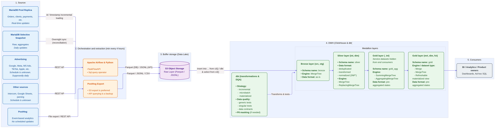

# 1. Выявление потребностей и уточняющие вопросы для бизнес-стейкхолдеров
##### 1. Data Freshness, SLAs & Business Criticality
* **Требования к задержке:** Действительно ли всем 169 таблицам MariaDB требуется синхронизация каждые 4 часа? Разделение таблиц по уровням приоритета (например, ключевые продуктовые события раз в 4 часа против статичных справочников раз в сутки) позволит существенно снизить нагрузку на реплику и затраты на вычисления.
* **Real-Time против микробатчей:** Существуют ли операционные дашборды, триггеры алертинга или пользовательские фичи, которым требуется задержка менее минуты / near-real-time (что оправдало бы внедрение CDC/Kafka на первом этапе), или 4-часового батч-SLA достаточно для всех текущих аналитических задач?

##### 2. Глубина истории, обновления и хранение данных
* **Необходимость SCD2:** Для изменяемых таблиц без колонки `updated_at` (таких как `usr_01` объемом 13.1 ГБ или `mkt_01` объемом 18.2 ГБ) нужно ли бизнесу отслеживать полную историю изменения состояний во времени, или достаточно только последнего актуального состояния?

* **Политика хранения и архивации:** Какое окно исторических данных (lookback window) требуется для аналитики в горячем хранилище ClickHouse (например, 1–2 года для prd_03 / prd_05), и по истечении какого срока старые партиции можно архивировать исключительно в холодное хранилище S3 для оптимизации затрат на NVMe/SSD?

##### 3. Владение источниками и эволюция схем
* **Изменение схем на источнике и возможность добавления `updated_at`:** Могут ли бэкенд-разработчики добавить индексируемую колонку/триггер updated_at в самые крупные изменяемые таблицы (mkt_01, usr_01) или включить бинарное логирование MariaDB (binlog_format=ROW) для будущего CDC? Если нет, каково максимальное ожидаемое окно ретроактивных обновлений (например, изменяются ли записи спустя более чем 7–14 дней после создания)?

* **Актуальность таблиц и устаревшие данные:** Сколько из 169 таблиц MariaDB реально используются для расчета бизнес-KPI, а какие являются legacy/устаревшими и могут быть исключены из первоначальной загрузки?

##### 4. Безопасность, персональные данные и управление доступом
* **Персональные данные и комплаенс**: Какие конкретно колонки в `usr_01` и транзакционных логах содержат персональные данные (email-адреса, IP, имена), и какая политика анонимизации требуется (хеширование, маскирование или ролевое ограничение на уровне колонок) перед передачей данных в BI-инструменты (если это не обрабатывается заранее)?

* **Профили потребителей и конкурентность запросов:** Кто является основными потребителями слоя gold (соотношение пользователей BI-дашбордов и ad-hoc SQL-аналитиков) и какая пиковая конкурентность запросов ожидается в рабочие часы?

# 2. Схема архитектуры

# 3-4. Извлечение, хранение и надежность
## 1. Источники данных
##### **Prod-реплика MariaDB**
**Что:** 169 таблиц (~669 млн строк, 217 ГБ).
**Когда:** Инкрементальные запуски каждые 4 часа для ключевых операционных сущностей.
- ***Оптимизация:*** Данные разделены на уровни (тиры) в зависимости от бизнес-критичности и частоты изменений (например, транзакционные таблицы `pay_*`, `prd_*` и пользовательские `usr_*` против статичных справочников `ref_*`). Не всем таблицам требуется одинаковая частота синхронизации. Горячие транзакционные таблицы синхронизируются 5–10 раз в день, тогда как холодные справочники или логи могут синхронизироваться раз в сутки.

**Как:**
- ***Проблема:*** В 166 из 169 таблиц MariaDB полностью отсутствует колонка `updated_at`. Если существующая запись (например, профиль пользователя в `usr_01`) обновляется на месте (in-place), её первичный ключ (`id`) и время создания остаются неизменными. Стандартный high-watermark запрос (`WHERE id > :last_max_id`) полностью пропустит это обновление.
- ***Дешевый вариант (если отсутствие мутаций гарантировано):*** Для логов событий (append-only) используется стандартная high-watermark пагинация по `id` или дате события. Для изменяемых таблиц сущностей без `updated_at` мы полагаемся на скользящие окна по партициям/диапазонам дат (периодически перезаливая активные партиции, например, за последние 3–7 дней) в сочетании с дедупликацией через `ReplacingMergeTree` в слое Silver.
- ***Дорогой вариант (100% захват изменений):*** CDC + Kafka путем чтения бинарного лога MariaDB (binlog).
 

##### Рекламные API
**Что:** Маркетинговые расходы, показы, клики и метрики конверсий.
**Когда:** Каждые 4 часа.
**Как:**
- ***API-курсоры и инкрементальная синхронизация:*** Использование нативных параметров пагинации API, дельта-токенов или фильтров по дате (`updated_from >= :last_sync_timestamp`), если они поддерживаются источником.
- ***Обработка окна атрибуции:*** Поскольку конверсии могут долетать спустя несколько дней после клика, пайплайн забирает скользящее окно ретроспективы за последние 7 дней. Вместо дорогостоящего построчного сравнения хешей в Python новые срезы просто перезаписывают соответствующие дневные/часовые партиции в ClickHouse, обеспечивая идемпотентность и чистоту данных без лишней нагрузки на CPU.
 

##### PostHog
**Что:** Сырые события продуктовой телеметрии.
**Когда:** Каждые 1–4 часа.
**Как:**
- ***Пакетный экспорт PostHog в S3:*** Сервис на своей стороне упаковывает события в файлы Parquet/JSONL и асинхронно стримит их напрямую в наш S3-бакет.
- ***Резервный API:*** REST API PostHog зарезервирован исключительно как бэкап или для точечных запросов по требованию, что позволяет избежать тяжелого стриминга событий по HTTP.
 

##### Другие источники
**Что:** Операционные таблицы и выгрузки из сторонних CRM.
**Когда:** Каждые 4 часа.
**Как:** Легковесные скрипты в Airflow, выполняющие полную перезапись для небольших справочных датасетов, чтобы пайплайны оставались простыми и удобными в поддержке.
 

##### *Дополнительная рекомендация
**Что:** Тяжелые системные логи ClickHouse
**Когда:** Не применимо (N/A).
**Как:** Настройка TTL или перенос старых логов в холодное хранилище S3 позволит сэкономить высокопроизводительные SSD-диски и бюджет.

## 2. Оркестрация и надежность (Apache Airflow)
**Что:** Централизованная оркестрация рабочих процессов с использованием Apache Airflow, управляющая выполнением DAG-ов, зависимостями задач и расписаниями во всех пайплайнах загрузки и трансформации.
**Как:**
- ***Идемпотентность:*** Каждый запуск записывает неизменяемый файл Parquet/JSONL, названный в соответствии с его плановым интервалом, внутрь S3-пути с партиционированием по дате (например, `s3://dwh-datalake/raw/{source}/{table}/date={{ ds }}/batch_{{ data_interval_start.strftime('%H%M') }}.parquet`). Поскольку `data_interval_start` остается неизменным при повторных попытках (retries) задачи, перезапуск упавшей джобы безопасно перезаписывает ровно тот же целевой файл без создания дубликатов или расхождения данных.
- ***Повторные попытки и экспоненциальная задержка*** Задачи настроены с автоматическими повторами (например, `retries=3`, `retry_delay=5 минут` с экспоненциальной задержкой) для корректной обработки временных сетевых сбоев, лимитов API или кратковременных обрывов соединения с репликой MariaDB.
- ***Контроль качества данных и алерты по объемам:*** Автоматические проверки (через dbt-тесты и кастомные Python-операторы). Если свежезагруженный батч содержит 0 строк или количество строк падает более чем на 50% по сравнению со средним историческим значением за неделю, пайплайн падает и немедленно отправляет алерт.
- ***Алертинг и управление инцидентами:*** Критические сбои пайплайнов и нарушения SLA отправляют автоматические уведомления в Telegram/Slack-канал команды Data Engineering через Airflow `on_failure_callback`, содержащие DAG ID, имя задачи и логи ошибок для быстрого траблшутинга.

## 3. Буферное хранилище и повторная загрука
**Что:** Промежуточный неизменяемый слой Data Lake, построенный поверх S3-совместимого объектного хранилища. Он хранит сырые извлеченные данные «как есть» в структурированных партиционированных путях (`s3://dwh-datalake/raw/{source}/{table}/date={{ ds }}/`).
**Зачем:**
- ***Изоляция продакшн-систем:*** Прямые аналитические запросы или тяжелые задачи выгрузки из ClickHouse к реплике MariaDB или внешним API могут серьезно снизить производительность источников или упереться в лимиты запросов. S3 выступает надежным буфером, который полностью отделяет извлечение данных от последующих трансформаций.
- ***Оптимизация форматов данных:*** Сырые данные из API и транзакционных дампов конвертируются в формат Parquet во время загрузки. Parquet обеспечивает эффективное колоночное сжатие и высокую скорость аналитического чтения для ClickHouse (через табличный движок `s3()`).
- ***Открытые табличные форматы и расширяемость:*** Структурируя сырые данные в S3, мы получаем архитектурную гибкость для наложения поверх них табличных форматов вроде Apache Iceberg или Delta Lake в будущем. Это позволяет независимым вычислительным движкам (таким как Spark, Trino или DuckDB) обращаться напрямую к стейджинг-слою без привязки стека к одному вендору баз данных.

**Как:**
- ***Неизменяемое хранилище для повторной обработки:*** Если в нижестоящей dbt-модели обнаружен баг или таблицы ClickHouse необходимо пересобрать с нуля, инженерам не нужно повторно опрашивать продакшн-реплику MariaDB или внешние API.
- ***Детерминированная повторная загрука из S3*** Airflow запускает чистый перезапуск, считывая исторические Parquet-файлы напрямую из S3 в слои Bronze/Silver. Это гарантирует нулевую нагрузку на продакшн во время отладки, дозагрузки исторических данных или эволюции схем.

## 4. Хранилище данных и трансформации
**Что:** Трехуровневая архитектура Medallion (Bronze → Silver → Gold), развернутая на ClickHouse, с оркестрацией и трансформациями через dbt.
**Как**:
- ***Слой Bronze (Сырая загрузка):***
- *Назначение:* Служит точной, невалидированной посадочной зоной для сырых данных, загружаемых из Parquet-файлов в S3 (через табличные функции ClickHouse `s3()` или `S3Queue`), а также внутренних логов ClickHouse в реальном времени (`prd_01`, `prd_02`).
- *Движок хранения:* `MergeTree` (append-only) с партиционированием по месяцу загрузки/события (`PARTITION BY toYYYYMM(dt)`), что обеспечивает быструю запись и изолированное управление партициями.

- ***Слой Silver (Очистка, типизация и дедупликация):***
- *Назначение:* Стандартизированные схемы, явные типы данных, нормализация часовых поясов (UTC) и дедупликация сущностей.
- *Дедупликация и обработка обновлений:* Для изменяемых сущностей без колонки `updated_at` (перезагружаемых через скользящие окна) мы используем `ReplacingMergeTree(version_col)` в сочетании с инкрементальными моделями dbt. Вместо тяжелых по памяти оконных функций (`ROW_NUMBER()`) dbt использует нативные для ClickHouse агрегации `argMax()/argMin()` или `LIMIT 1 BY id` вместе с перезаписью на уровне партиций (стратегия `insert_overwrite`), благодаря чему нижестоящие запросы никогда не читают дубликаты и не зависят от дорогих модификаторов `FINAL`.
- *Отслеживание истории:* Чтобы закрыть бизнес-требования по историческому анализу на конкретный момент времени (point-in-time, например, отслеживание смены тарифов пользователя или переходов между статусами во времени), мы применяем нативный `dbt snapshot`. Это формирует медленно изменяющиеся измерения второго типа (SCD Type 2) с автоматическим ведением интервалов `dbt_valid_from` и `dbt_valid_to`, в то время как сырые append-only журналы аудита надежно сохраняются в S3.

- ***Слой Gold (Внутренние предагрегации):***
- *Назначение:* Скрытый сервисный слой, хранящий промежуточные предагрегированные состояния (`SummingMergeTree`, `AggregatingMergeTree`, отдельные таблицы на движке `Merge`).
- *Изоляция и безопасность:* Намеренно скрыт от конечных потребителей и BI-инструментов через RBAC. Прямая работа с колонками состояний `AggregatingMergeTree` (`AggregateFunction`) требует специфического синтаксиса ClickHouse (комбинаторы `-State` / `-Merge`) и глубокого понимания механики фоновых слияний (background merges). Изоляция этих датасетов в `gold_agg` не позволяет нетехническим пользователям и аналитикам обращаться к сырым промежуточным состояниям и некорректно интерпретировать несмерженные метрики.

- ***Слой Gold (Бизнес-витрины)***:
- *Назначение:* Аналитический слой для конечных потребителей, содержащий чистые таблицы измерений (dim) и фактов (fct) в схеме «звезда», а также широкие бизнес-витрины (mrt), готовые для BI-инструментов и ad-hoc запросов.
- *Движки и материализация:* Построены на стандартном `MergeTree`, табличном движке `Merge` (для бесшовного объединения шардированных или исторических таблиц) и обновляемых материализованных представлениях (Refreshable Materialized Views), обеспечивая чистые, финализированные и человекочитаемые типы данных с субсекундной скоростью выполнения запросов.

## 5. Потребители данных и слой витрин
**Что:** Нижестоящий слой потребления, где BI-инструменты, аналитики и автоматизированные сервисы запрашивают финализированные датасеты строго из схемы `gold`.
**Ключевые интерфейсы потребителей и паттерны обслуживания:**
- ***BI и Self-Service аналитика:***
- *Назначение:* Автоматизированные управленческие дашборды, продуктовые воронки и отчеты по маркетинговой атрибуции.
- *Оптимизация выдачи:* BI-инструменты подключаются исключительно к заранее смоделированным витринам `gold`. Поскольку тяжелые джойны и агрегации уже выполнены выше по потоку в dbt, запросы дашбордов отрабатывают с субсекундной задержкой, не нагружая CPU/RAM ClickHouse.
- ***Ad-Hoc SQL-исследования:***
- *Назначение:* Глубокие когортные исследования, оценка A/B-тестов и кастомный анализ фич.
- *Ограничения и квоты ресурсов:* Аналитики делают запросы к `gold` через выделенные read-only профили ClickHouse с жесткими лимитами ресурсов (`max_memory_usage`, `max_execution_time`). При этом схемы `bronze`, `silver` и `gold_agg` остаются недоступными через RBAC, чтобы предотвратить случайные запросы к сырым логам или несмерженным состояниям `AggregateFunction`.
- ***Reverse ETL и нижестоящие интеграции***:
- *Назначение:* Передача рассчитанных пользовательских сегментов, скоринга оттока или статусов подписок обратно в CRM/маркетинговые платформы или продуктовые сервисы.
- *Реализация:* Запланированные экспорты Airflow/dbt считывают финализированные срезы из витрин `gold` и отправляют обновления через API или экспорт в S3, изолируя операционные базы данных от аналитических нагрузок.
- ***SLA для потребителей и контракты данных (Data Contracts):***
- *Назначение:* Обеспечение предсказуемой доступности данных и четких ожиданий для бизнес-пользователей.
- *Гарантия свежести:* Конечные потребители полагаются на предсказуемую свежесть данных, синхронизированную с 4-часовым циклом обновления MariaDB и ежедневными маркетинговыми сводками, что подкрепляется проверками `dbt source freshness` и автоматическими алертами в Slack/Telegram, если задержка на источнике влияет на доступность таблиц `gold`.
- ***Интегрированный слой метаданных dbt и портал документации***
- *Назначение:* Обеспечивает бизнес-аналитиков и потребителей данных возможностью самостоятельного поиска, предоставляя прозрачные определения метрик и схем таблиц без бутылочных горлышек в виде инженеров.
- *Слой метаданных:* Фиксация явных описаний колонок, владельцев данных и определений бизнес-логики непосредственно в `.yml` конфигурационных файлах dbt рядом с кодом трансформаций.
- *Нативная документация:* Публикация интерактивного веб-каталога через `dbt docs generate`, привязанного к CI/CD-пайплайнам, что дает потребителям мгновенную видимость происхождения данных и их свежести перед выполнением запросов к слою `gold`.

# 5. Администрирование, управление данными и планирование
##### Контроль доступа и изоляция схем
**Что:** Строгий ролевой доступ (RBAC) на уровне базы данных, обеспечивающий разделение пространств имен между `bronze`, `silver`, `gold_agg` и `gold`.
**Зачем:** Предотвращает случайные запросы бизнес-аналитиков и BI-инструментов к сырым логам загрузки (`bronze`) или несмерженным состояниям `AggregateFunction` (`gold_agg`), исключая ошибки в расчете метрик и тяжелые неоптимизированные полные сканирования таблиц.
**Как:**
* Выдать права на чтение строго на потребительскую схему `gold` (`mrt`, `dim`, `fct`) для сервисных учетных записей BI и аналитиков.
* Отозвать всю видимость и доступ к `bronze`, `silver` и внутренним таблицам предагрегаций для неинженерных ролей.
* Установить квоты ресурсов на запросы (`max_memory_usage`, `max_execution_time`) в профилях ad-hoc пользователей, чтобы изолировать продакшн-пайплайны dbt от всплесков пользовательских запросов.
 

##### Анонимизация персональных данных и приватность
**Что:** Автоматическое хеширование и маскирование PII перед передачей данных в аналитический слой.
**Зачем:** Обеспечивает соответствие требованиям регуляторов по защите данных и защищает чувствительные идентификаторы пользователей, извлеченные из операционных таблиц, от несанкционированного раскрытия в нижестоящих BI-инструментах.
**Как:**
* Выявлять поля с PII (email-адреса, IP-адреса, номера телефонов) на этапе маппинга при загрузке.
* Применять детерминированное соление (salting) и хеширование SHA-256 (или маскирование на уровне колонок) внутри dbt-трансформаций на шаге Bronze $\rightarrow$ Silver, гарантируя, что сырые PII никогда не попадут в слой `gold`, при этом сохраняя возможность объединять записи по пользовательским сущностям.
 

##### Аварийное восстановление и стратегия резервного копирования (S3-First подход)
**Что:** Воспроизводимое восстановление хранилища без сохранения состояния (stateless), опирающееся на неизменяемый S3-стейджинг и декларативный код dbt вместо традиционных снапшотов баз данных.
**Зачем:** Традиционные файловые бэкапы ClickHouse (`clickhouse-backup`) для многотерабайтных таблиц раздувают объем хранения, создают сетевую нагрузку и усложняют эксплуатацию без реальной пользы, когда сырые данные уже надежно сохранены.
**Как:**
- Все сырые выгрузки из MariaDB, маркетинговых API и PostHog хранятся в виде неизменяемых Parquet-файлов в S3 с включенным версионированием бакетов и политиками жизненного цикла (lifecycle policies).
- Поскольку все трансформации слоев `Silver`, `gold_agg` и `Gold` версионируются в dbt, любая поврежденная таблица или вышедшая из строя нода ClickHouse может быть чисто пересобрана с нуля путем перезапуска инкрементальных моделей dbt поверх S3.
- Легковесные автоматические бэкапы поддерживаются исключительно для базы метаданных Airflow, артефактов dbt и DDL-схем/конфигураций ClickHouse.
 

##### План внедрения (Первые 1–2 месяца — Фаза 1 MVP)
**Недели 1–2 — Инфраструктура, S3-стейджинг и слой Bronze:**
- Развернуть S3-бакеты и Apache Airflow.
- Построить идемпотентные DAG-и извлечения данных в Airflow для таблиц MariaDB, приоритизируя сущности с наибольшим объемом.
- Развернуть append-only таблицы `MergeTree` в слое Bronze с партиционированием по месяцам (`toYYYYMM(dt)`).

**Недели 3–4 — Интеграция dbt и слой Silver:**
- Настроить структуру проекта `dbt-clickhouse` и CI/CD-пайплайны.
- Реализовать инкрементальные модели Silver с использованием `insert_overwrite`, перезагрузки скользящим окном и безопасной по памяти дедупликации (`argMax` / `LIMIT 1 BY id`).
- Настроить `dbt snapshot` для критичных бизнес-сущностей по типу SCD Type 2 и внедрить базовые dbt-тесты (`unique`, `not_null`).

**Недели 5–6 — Витрины Gold, предагрегации и RBAC:**
- Построить ключевые измерения (dimensions), факты (facts) по схеме «звезда» и бизнес-витрины в схеме `gold` (а также внутренние роллапы `gold_agg`, где это необходимо).
- Применить политики ClickHouse RBAC, правила маскирования PII и подключить BI-инструменты (Superset / Metabase).

**Недели 7–8 — Наблюдаемость, алертинг и передача в продакшн:**
- Включить мониторинг свежести источников (`dbt source freshness`), интегрированный с алертами в Slack/Telegram для отслеживания задержек загрузки на источниках.
- Провести мониторинг системных таблиц ClickHouse (`system.query_log`, `system.parts`) под реальной конкурентной нагрузкой BI и тюнинг порогов памяти и слияний (merges).
- Финализировать документацию каталога данных и провести онбординг аналитиков.
