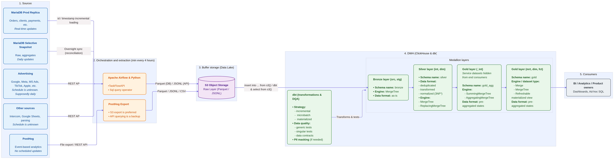

# 1. Discovery & Clarifying Questions for Business Stakeholders
##### 1. Data Freshness, SLAs & Business Criticality
* **Tiered Latency Requirements:** Do all 169 MariaDB *objects* (152 base tables + 17 views) actually require a 4-hour sync cadence? Separating tables into priority tiers (e.g., core product events every 4 hours vs. static lookup dimensions once a day) can significantly reduce replica load and compute costs.
* **Real-Time vs. Micro-Batch Needs:** Are there any operational dashboards, alerting triggers, or customer-facing features that require sub-minute/near-real-time latency (which would justify a Phase 1 CDC/Kafka setup), or is a 4-hour batch SLA sufficient for all current analytical use cases?

##### 2. Historical Depth, Updates & Data Retention
* **SCD2 Scope:** For mutable tables lacking an `updated_at` column (such as `usr_01` at 13.1 GB or `mkt_01` at 18.2 GB), does the business need to track full historical state transitions over time, or is only the latest operational state needed?
* **Retention & Archival Policy:** What is the analytical lookback window required in ClickHouse hot storage (e.g., 1–2 years for `prd_03` / `prd_05`), and after what period can older partitions be archived exclusively to cold S3 storage to optimize NVMe/SSD costs?

##### 3. Source Ownership & Schema Evolution
* **Upstream Schema Changes & updated_at Feasibility:** Can backend engineers add an indexed `updated_at` trigger/column to the largest mutable tables (`mkt_01`, `usr_01`, `prd_03`, `prd_05`), or enable MariaDB binary logging (`binlog_format=ROW`) for future CDC? If not, what is the maximum expected retroactive update window (e.g., do records ever get modified more than 7–14 days after creation)?
* **Delete Semantics:** Are rows ever hard-deleted in MariaDB (e.g., GDPR erasure, order cancellation, user removal)? Hard deletes are invisible to any high-watermark or timestamp-based incremental load and require an explicit `is_deleted` marker or a periodic anti-join reconciliation.
* **Table Scope & Deprecation:** Out of the 169 objects, how many are actively needed for business KPIs versus legacy/deprecated tables (views, `pay_ext_*_raw`/`_test` staging pairs, date-stamped backups) that can be excluded from initial ingestion?

##### 4. Existing ClickHouse Ownership
* **Authoritative or Derived?** 19 ClickHouse objects have no MariaDB counterpart (`prd_01`, `prd_02`, `prd_04`, `prd_07`, `prd_08`, `prd_10`, `prd_13`, `prd_18`, `prd_19`, `prd_25`, `pay_06`, `pay_07`, `pay_10`, `pay_12`, `pay_13`, `pay_22`, `svc_01`, `ref_04`, `mkt_18`, plus materialized view `prd_42` and views `v_18`/`v_19`). Who owns these, are they fed in real time by application code, and may the new pipeline rename/relocate them into bronze/silver, or must the current table names stay intact for existing consumers?
* **Which layer is the current source of truth today** for `prd_07` (snapshot_date), `prd_08` (valid_from) and `prd_10` (SummingMergeTree) — MariaDB, application writes, or ClickHouse-side aggregation?

##### 5. Security, PII & Access Governance
* **PII & Compliance Constraints**: Which specific columns in `usr_01` and transactional logs contain Personally Identifiable Information (emails, IPs, names), and what is the required anonymization policy (hashing vs. masking vs. role-based column restrictions) before exposing data to BI tools? This must also cover the raw S3 layer, where Parquet files retain payloads verbatim.
* **Consumer Profiles & Concurrency:** Who are the primary consumers of the gold layer (number of BI dashboard viewers vs. ad-hoc SQL analysts), and what are the peak concurrency expectations during business hours?

# 2. Architecture schema

# 3-4. Extraction & Storage & Reliability
## 1. Sources
### Verified source inventory (from the provided table listings)
| Metric | Value |
|---|---|
| Objects in MariaDB listing | 169 (152 base tables + 17 views `v_01`…`v_17`) |
| Total rows (base tables) | ~668.9 M |
| Total size on disk | ~217 GB |
| Base tables with `updated_at` | 3 (`mkt_12`, `msg_11`, `svc_06`) — 16,791 / 22 / 0 rows |
| Effective ingestion scope | ~140 tables (~99.9% of volume) |
| ClickHouse objects today | 58 tables + 1 materialized view + 2 views |
| ClickHouse objects with no MariaDB source | 19 (+ `prd_42` MV, `v_18`, `v_19`) |

**Excluded from ingestion (confirmed by inspection of the table listing):**
* **17 views** (`v_01`…`v_17`) — not physical data; if their logic is needed it is re-implemented as a dbt model over synced base tables.
* **Staging / non-production artefacts:** `pay_ext_a_raw`…`pay_ext_e_raw` and `pay_ext_a_test`…`pay_ext_e_test`, plus date-stamped copies `mkt_meta_01_20260714` and `mkt_mmp_03_bak_20260814` (~780 K rows, ~0.5 GB). Subject to owner confirmation.
* **Empty tables:** `prd_41`, `mkt_mmp_05`, `svc_06` — ingest schema only, zero rows, no pipeline impact.

##### MariaDB Prod Replica
**What:** 152 base tables (~668.9 M rows, 217 GB), of which ~140 are in scope.
**When:** Incremental runs every 4 hours for core operational entities (`00/04/08/12/16/20 UTC`, i.e. 6 runs/day).
* ***Optimization:*** Data is tiered based on business criticality and frequency of change. Not all tables require the same sync frequency.

| Tier | Cadence | Tables (examples with real sizes) | Share of volume |
|---|---|---|---|
| **P0 — hot & mutable** | 6×/day | `prd_03` (148.3 M / 32.2 GB), `prd_05` (67.6 M / 30.5 GB), `usr_01` (56.1 M / 13.4 GB), `prd_06` (37.5 M / 11.9 GB), `msg_01` (33.5 M / 7.0 GB), `pay_01` (28.0 M / 6.5 GB), `pay_02` (28.5 M / 2.8 GB), `mkt_01` (23.8 M / 18.6 GB), `prd_09` (22.4 M / 12.2 GB), `pay_03`–`pay_05`, `msg_02`/`msg_03`, `prd_11`/`prd_12`, `mkt_mmp_01` | ~85% |
| **P1 — warm** | daily | `usr_02`–`usr_12`, `prd_14`–`prd_17`, `anl_01`–`anl_06`, remaining `mkt_*` / `mkt_*_01`, `pay_06`–`pay_11`, `msg_04`+ | ~15% |
| **P2 — reference & tail** | daily full overwrite | `ref_*`, `svc_*`, `usr_13`–`usr_16`, `prd_20`+, `mkt_12`+, `pay_12`+ (all < 500 K rows) | < 1% |

*Note:* `prd_05` (67.6 M rows / 30.5 GB) and `prd_09` (22.4 M / 12.2 GB) are the largest tables with **no ClickHouse counterpart today** — they are net-new ingestion, not a migration.

**How:**
**1. Change Capture Strategy (Incremental & Reconciliation):**
* ***The Problem:*** 149 of 152 base tables (98%) completely lack an `updated_at` column — and, critically, **none of the 20 largest tables has one**. If an existing record (e.g., a user profile in `usr_01`) is updated in place, its primary key (`id`) and creation timestamp remain unchanged. A standard high-watermark query (`WHERE id > :last_max_id`) will completely miss this update.
* ***Cheap (Baseline Incremental):*** For append-only event logs, standard high-watermark pagination by `id` or event date is used. For mutable entity tables without `updated_at`, we rely on partition/date-range sliding windows (periodically resyncing active partitions over the last 3–7 days) combined with write-time deduplication in the Silver layer.
* ***Reconciliation for P0 Mutable Tables (Required):*** Large mutable entities (`prd_03`, `prd_05`, `usr_01`, `mkt_01`) cannot be covered by a 7-day window alone, because updates routinely land weeks after creation. A weekly `id`-range checksum comparison (`CHECKSUM TABLE` per range, or `SUM(CRC32(CONCAT_WS(...)))` over 1 M-row PK slices) against the last known snapshot produces the list of changed ranges, which are then re-extracted and overwritten partition-wise without a full-table scan on either side.
* ***Expensive (Strategic Target for P0):*** 100% change capture via CDC + Kafka by tailing the MariaDB binary log (`binlog_format=ROW`) once enabled upstream.

**2. Replica Protection & Extraction Integrity:**
* ***Extraction Mechanics:*** Every task first asserts replica health (`SHOW REPLICA STATUS` → `Seconds_Behind_Source` below threshold, replication thread running) and aborts without writing if the replica lags. Reads are chunked by primary-key ranges (bounded `WHERE id BETWEEN …`, no long-lived transactions), run under `--single-transaction` semantics, and are throttled so that extraction never saturates the replica.
* ***Delete Handling:*** Hard deletes are undetectable via high-watermarks. Bronze keeps append-only history; Silver resolves the current state with a `ReplacingMergeTree(is_deleted)` marker or a periodic anti-join against the replica for P0 tables, so deleted entities disappear from gold marts.
* ***Schema Drift:*** Each run snapshots `INFORMATION_SCHEMA.COLUMNS` for the extracted tables into S3 (`_schema/{table}/{run}.json`) and diffs it against the previous snapshot. Added, renamed, or dropped columns trigger an alert instead of silently shifting `SELECT *` output.
 

##### ClickHouse-native sources
**What:** 19 tables plus MV `prd_42` and views `v_18`/`v_19` that exist only in ClickHouse.
**When:** Continue as-is in Phase 1; unified into bronze namespace in Phase 2.
**How:**
* `prd_01` (693.6 M rows) and `prd_02` (289.3 M rows) are high-volume internal logs — they stay native and become bronze-adjacent sources, with TTL to move cold partitions to S3.
* `prd_07` (`snapshot_date`), `prd_08` (`valid_from`) and `prd_10` (`SummingMergeTree`) already implement the SCD2 and pre-aggregation patterns described below. The new pipeline **reuses these conventions and existing table names** rather than re-deriving them, and these tables are not renamed without an explicit consumer sign-off.
 

##### Advertising APIs
**What:** Marketing spend, impressions, clicks, and conversion metrics.
**When:** Every 4 hours.
**How:**
* ***API Cursors & Incremental Sync:*** Utilizing native API pagination parameters, delta-tokens, or date filters (`updated_from >= :last_sync_timestamp`) when provided by the source.
* ***Attribution Window Handling:*** Because conversions can arrive days after a click, the pipeline pulls a sliding lookback window of the past 7 days. Instead of expensive row-by-row hash comparisons in Python, new slices simply overwrite the respective daily/hourly partitions in ClickHouse, ensuring idempotency and clean data without CPU overhead.
 

##### PostHog
**What:** Raw product telemetry events.
**When:** Every 1-4 hours.
**How:**
* ***PostHog S3 Batch Export:*** The service packages events into Parquet/JSONL files on its end and asynchronously streams them directly to our S3 bucket.
* ***API Fallback:*** The PostHog REST API is reserved solely as a backup or for on-demand targeted queries, avoiding heavy event-streaming over HTTP.
 

##### Other Sources
**What:** Operational spreadsheets and third-party CRM exports.
**When:** Every 4 hours.
**How:** Lightweight Airflow scripts performing full overwrites for small reference datasets to keep pipelines simple and maintainable.
 

##### *Extra suggestion
**What:** ClickHouse heavy logs
**When:** N/A.
**How:** Setting up TTL or moving old logs to cold S3 storage will save high performance SSD and money.

## 2. Orchestration & Reliability (Apache Airflow)
**What:** Centralized workflow orchestration using Apache Airflow, managing the execution DAGs, task dependencies, and schedules across all ingestion and transformation pipelines.
**How:**
* ***Idempotency:*** Each run writes an immutable Parquet/JSONL file named after its scheduled interval inside a date-partitioned S3 path (e.g., `s3://dwh-datalake/raw/{source}/{table}/date={{ ds }}/batch_{{ data_interval_start.strftime('%H%M') }}.parquet`). Because `data_interval_start` remains fixed across task retries, re-running a failed job safely overwrites the exact same target file without creating duplicates or data drift.
* ***Retries & Exponential Backoff:*** Tasks are configured with automatic retries (e.g., `retries=3`, `retry_delay=5 minutes` with exponential backoff) to gracefully handle transient network glitches, API rate limits, or momentary drops in the MariaDB replica connection.
* ***Replica & Source Guards:*** A `check_source_health` task runs before extraction and fails the run if replica lag exceeds the threshold, binlog position is stale, or an upstream API returns a quota error — preventing partial/garbage batches from being staged.
* ***Data Quality & Volume Alerts:*** Automated checks (via dbt tests and custom Python operators). If a newly ingested batch contains 0 rows or if row count drops by more than 50% compared to the historical weekly average, the pipeline fails and immediately triggers an alert.
* ***Alerting & Incident Management:*** Critical pipeline failures and SLA breaches send automated notifications to the Data Engineering team's Telegram/Slack channel via Airflow `on_failure_callback`, containing the DAG ID, task name, and error logs for fast troubleshooting.
* ***Backfills:*** Because S3 is the only read dependency for reprocessing, a backfill is expressed as `INSERT INTO bronze.{table} SELECT … FROM s3(…)` over an explicit interval — never as a re-query of production sources.

## 3. Buffer Storage & Replay
**What:** An intermediate immutable data lake layer built on top of S3-compatible object storage. It stores raw extracted data as-is in structured partitioning paths (`s3://dwh-datalake/raw/{source}/{table}/date={{ ds }}/`).
**Why:**
* ***Production Isolation:*** Direct analytical queries or heavy extraction jobs from ClickHouse running against the MariaDB replica or external APIs can severely degrade source performance or hit rate limits. S3 acts as a reliable buffer that completely decouples data extraction from downstream transformations.
* ***Data Format Optimization:*** Raw payloads from APIs and transactional dumps are converted into Parquet format during ingestion. Parquet provides efficient columnar compression and high-speed analytical read performance for ClickHouse (via the s3() table engine).
* ***Open Table Formats & Extensibility:*** By structuring raw data in S3, we have the architectural flexibility to overlay table formats like Apache Iceberg or Delta Lake in the future. This enables decoupled compute engines (such as Spark, Trino, or DuckDB) to query the staging layer directly without locking the stack into a single database vendor.

**How:**
* ***Immutable Storage for Reprocessing:*** If a downstream dbt model contains a bug, or if ClickHouse tables need to be rebuilt from scratch, engineers do not re-query the production MariaDB replica or external APIs.
* ***Deterministic S3 Replay:*** Airflow triggers a clean re-run by reading historical Parquet files directly from S3 into the Bronze/Silver layers. This guarantees zero production load during debugging, data backfilling, or schema evolution.
* ***Governance of the raw layer:*** The raw zone contains PII verbatim, so bucket-level controls are part of the design, not an afterthought — SSE-KMS encryption, blocked public access, bucket versioning, write-only access for ingestion roles and read access only through the ClickHouse role, plus a lifecycle policy (Standard → IA at 30 days → Glacier IR at 180 days) so replay capability survives while cost stays bounded.

## 4. Data Warehouse & Transformations
**What:** A three-tier Medallion Architecture (Bronze → Silver → Gold) hosted on ClickHouse, orchestrated and transformed via dbt.
**How**:
* ***Bronze Layer (Raw Ingestion):***
    * *Purpose:* Serves as an exact, unvalidated landing zone for raw data loaded from S3 Parquet files (via ClickHouse s3() table functions or S3Queue) as well as internal real-time ClickHouse logs (`prd_01`, `prd_02`).
    * *Storage Engine:* MergeTree (append-only) partitioned by ingestion/event month (`PARTITION BY toYYYYMM(dt)`), ensuring fast writes and isolated partition management.

* ***Silver Layer (Cleaned, Typed & Deduplicated):***
    * *Purpose:* Standardized schemas, explicit data types, timezone normalization (UTC), and entity deduplication.
    * *Deduplication is resolved at write time, not at read time:* ReplacingMergeTree only collapses duplicates **during background merges** — a query issued before the merge (and any consumer that omits `FINAL`) will happily read duplicates, which is exactly the failure visible in the current warehouse, where several `ReplacingMergeTree ORDER BY id` tables hold more rows than their MariaDB source (`mkt_03` +651%, `msg_01` +82%, `mkt_02` +41%, `usr_01` +8%, and conversely `usr_03` −2%). Therefore each incremental Silver model writes a **deterministic one-row-per-key result** using ClickHouse-native `argMax(col, version) GROUP BY id` or `LIMIT 1 BY id` inside the model, and applies `insert_overwrite` per affected partition, so downstream reads need neither `FINAL` nor a lucky merge schedule. In the prototype (in the repository) this principle is implemented as `stg_*` tables on `ReplacingMergeTree(_version, _is_deleted)` combined with incremental rebuilds of only the changed partitions in `int_*` tables on plain `MergeTree` (`insert_overwrite` + `FINAL` + `_is_deleted = 0`), with batch watermarks and CDC offsets tracked via the `get_cdc_watermarks` macro.
    * *History Tracking:* To handle business requirements for point-in-time historical analysis (e.g., tracking user plan changes or status transitions over time), SCD2 is derived from the append-only Bronze trail using the `valid_from`/`valid_to` convention adopted in the existing `prd_08` table. Native `dbt snapshot` is reserved for narrow dimensions (well under 5 M rows), because a snapshot against a 50 M+ row entity re-scans the entire table on every run.

* ***Gold Layer (Internal Pre-Aggregations):***
    * *Purpose:* Hidden service layer storing intermediate pre-aggregated states (SummingMergeTree, AggregatingMergeTree, separate tables using the Merge engine) — an extension of the pattern already present in `prd_10`.
    * *Isolation & Safety:* Intentionally hidden from end consumers and BI tools via RBAC. Working directly with AggregatingMergeTree state columns (AggregateFunction) requires specialized ClickHouse syntax (-State / -Merge combinators) and deep awareness of background merge mechanics. Isolating these datasets in `gold_agg` prevents non-technical users and analysts from querying raw intermediate states and misinterpreting unmerged metrics.

* ***Gold Layer (Business Marts)***:
    * *Purpose:* Consumer-facing analytical layer containing clean star-schema dimensions (dim), facts (fct), and wide business marts (mrt) ready for BI tools and ad-hoc querying.
    * *Engines & Materialization:* Built on standard MergeTree, Merge table engines (for seamless union across sharded or historical tables), and Refreshable Materialized Views, providing clean, finalized, and human-readable data types with sub-second query performance.
    * *Naming and migration:* existing ClickHouse consumers keep their table names until an explicit switch; the new `mrt_*`/`dim_*`/`fct_*` objects are introduced alongside and cut over per report, so `prd_42`/`v_18`/`v_19` definitions can be rebuilt without a breaking change.

## 5. Data Consumers & Serving Layer
**What:** The downstream consumption layer where business intelligence tools, analysts, and automated services query finalized datasets strictly from the gold schema.
**Key Consumer Interfaces & Serving Patterns:**
* ***BI & Self-Service Analytics:***
    * *Purpose:* Automated executive dashboards, product funnels, and marketing attribution reports.
    * *Serving Optimization:* BI tools connect exclusively to pre-modeled gold marts. Because heavy joins and aggregations are already resolved upstream in dbt, dashboard queries execute in sub-second latency without straining ClickHouse CPU/RAM.
* ***Ad-Hoc SQL Exploration:***
    * *Purpose:* Deep-dive cohort investigations, A/B test evaluations, and custom feature analysis.
    * *Guardrails & Resource Quotas:* Analysts query gold using dedicated ClickHouse read-only user profiles (`readonly = 1`) enforced with strict resource limits (`max_memory_usage`, `max_execution_time`, `max_concurrent_queries_for_user`). Meanwhile, bronze, silver, and gold_agg remain ungranted, so an accidental query against raw logs or unmerged `AggregateFunction` states fails with a permission error rather than silently returning wrong numbers.
* ***Reverse ETL & Downstream Integrations***:
    * *Purpose:* Pushing computed user segments, churn scores, or subscription statuses back into CRM/marketing platforms or product services.
    * *Execution:* Scheduled Airflow/dbt exports read finalized slices from gold marts and push updates via APIs or S3 exports, keeping operational databases decoupled from analytical workloads.
* ***Consumer SLA & Data Contracts:***
    * *Purpose:* Ensuring predictable data availability and clear expectations for downstream business users.
    * *Freshness Guarantee:* End consumers rely on predictable data freshness aligned with the 4-hour MariaDB sync cadence (6 runs/day) and daily marketing rollups, backed by `dbt source freshness` checks and automated Slack/Telegram alerts if an upstream delay impacts gold table availability.
* ***Integrated dbt metadata layer & documentation site***
    * *Purpose:* Empowers business analysts and data consumers with self-service discoverability, providing transparent definitions of metrics and table schemas without engineering bottlenecks.
    * *Metadata Layer:* Enforcing explicit column descriptions, data owners, and business logic definitions directly in dbt `.yml` configuration files alongside transformation code.
    * *Native Documentation:* Publishing an interactive web catalog via `dbt docs generate` linked to CI/CD pipelines, giving consumers immediate visibility into table lineage and freshness before querying the gold layer.

# 5. Administration, Governance & Planning
##### Access Control & Schema Isolation (RBAC)
**What:** Strict database-level RBAC enforcing namespace separation across bronze, silver, gold_agg, and gold.
**Why:** Prevents business analysts and BI tools from accidentally querying raw ingestion logs (bronze) or unmerged AggregateFunction states (gold_agg), eliminating miscalculated metrics and heavy unoptimized full-table scans.
**How:**
* Grant read permissions only on the consumer-facing gold schema (`GRANT SELECT ON gold.*`) for BI service accounts and analysts.
* Do not grant any access to bronze, silver, and gold_agg for non-engineering roles. ClickHouse cannot hide database *names* from users — only their contents — so isolation is enforced by grants plus `readonly = 1/2` profiles, not by expecting schemas to be invisible.
* Enforce query resource profiles (`max_memory_usage`, `max_execution_time`, `max_concurrent_queries_for_user`) on ad-hoc user profiles to isolate production dbt pipelines from user query spikes.
 

##### PII Anonymization & Data Privacy
**What:** Automated hashing and masking of PII before analytical exposure, plus controlled access to the raw layer where PII still exists in plain form.
**Why:** Ensures compliance with data privacy regulations and protects sensitive user identifiers extracted from operational tables from unauthorized exposure in downstream BI tools.
**How:**
* Identify PII fields (emails, IP addresses, phone numbers) during ingestion mapping and record them in a maintained PII column registry.
* Apply deterministic salting and SHA-256 hashing (or column-level masking) inside dbt transformations during the Bronze $\rightarrow$ Silver step, ensuring raw PII never reaches the gold layer while preserving joinability across user entities.
* Because the S3 raw zone necessarily holds unmasked payloads, it is protected independently: SSE-KMS encryption, no public access, ingestion-only write credentials, ClickHouse-only read credentials, and an auditable access trail.
 

##### Disaster Recovery & Backup Strategy (S3-First Approach)
**What:** Stateless, reproducible warehouse recovery relying on immutable S3 staging and declarative dbt code rather than traditional database snapshots.
**Why:** Traditional ClickHouse file-level backups (clickhouse-backup) for multi-terabyte tables add storage bloat, network overhead, and operational complexity without adding value when raw data is already durably persisted.
**How:**
* All raw extractions from MariaDB, marketing APIs, and PostHog are stored as immutable Parquet files in S3 with bucket versioning and lifecycle policies enabled.
* Because all Silver, gold_agg, and Gold transformations are version-controlled in dbt, any corrupted table or failed ClickHouse node can be cleanly rebuilt from scratch by re-running dbt incremental models against S3.
* Lightweight automated backups are maintained solely for Airflow metadata DB, dbt artifacts, and ClickHouse DDL schemas/configs.
* **Targets:** RPO 24 h for P2/P1 tables and 4 h for P0 tables (bounded by the S3 staging cadence); RTO 1 business day for a full silver/gold rebuild of P0 marts, exercised once per quarter with a restore drill rather than assumed.
 

##### Observability
**What:** Continuous monitoring of warehouse health alongside pipeline health.
**How:**
* ClickHouse internals: `system.parts` (partition count, part growth, inactive parts), `system.merges`, `system.query_log` (slow queries, memory peaks), `system.asynchronous_metrics`.
* Pipeline: per-table row-count and freshness dashboards, alerting on drift beyond a configurable threshold — this is what would have caught the existing discrepancies between ClickHouse and MariaDB row counts.
 

##### Implementation Roadmap (First 1–2 Months — Phase 1 MVP)
**Weeks 1–2 — Infrastructure, S3 Staging & Bronze Layer:**
* Provision S3 buckets (with KMS/lifecycle governance), Apache Airflow.
* Build idempotent Airflow extraction DAGs for the ~140 in-scope MariaDB tables, starting with the P0 tier (`prd_03`, `prd_05`, `usr_01`, `mkt_01`, `prd_06`, `pay_01`–`pay_05`, `msg_01`–`msg_03`), excluding the 17 views, the `pay_ext_*` staging pairs and the dated backups.
* Deploy Bronze append-only MergeTree tables partitioned by month (toYYYYMM(dt)).
* Add `check_source_health`, PK-range chunking and the `INFORMATION_SCHEMA` schema-drift snapshot from day one.

**Weeks 3–4 — dbt Integration & Silver Layer:**
* Configure dbt-clickhouse project structure and CI/CD pipelines.
* Implement incremental Silver models using `insert_overwrite`, sliding window reloads, and deterministic write-time deduplication (`FINAL` over `ReplacingMergeTree` or `argMax` / `LIMIT 1 BY id` when rebuilding partitions into plain `MergeTree`), so no downstream Gold consumer depends on `FINAL`.
* Implement the weekly PK-range checksum reconciliation for the four largest mutable tables.
* Configure the `valid_from`/`valid_to` SCD2 pattern derived from Bronze for critical entities; use `dbt snapshot` only for narrow dimensions. Set up baseline dbt tests (unique, not_null).

**Weeks 5–6 — Gold Marts, Pre-Aggregations & RBAC:**
* Build core star-schema dimensions, facts, and business marts in the gold schema (plus internal gold_agg rollups where needed).
* Apply ClickHouse RBAC profiles, PII masking rules, and connect BI tools (Superset / Metabase).

**Weeks 7–8 — Observability, Alerting & Production Handover:**
* Enable dbt source freshness monitors integrated with Slack/Telegram alerts for upstream ingestion delays.
* Monitor ClickHouse system tables (`system.query_log`, `system.parts`) under real BI concurrency and tune memory/merge thresholds.
* Finalize data catalog documentation and onboard analysts.

# Appendix A. Inventory verification & data-quality findings
The numbers quoted above were recomputed directly from the provided table listings.

**Confirmed:** 169 objects = 152 base tables + 17 views; 668,946,354 rows; 217,137 MB (~217 GB); `usr_01` 13,437 MB and `mkt_01` 18,629 MB as stated in section 1; `prd_01`/`prd_02` exist only in ClickHouse; all `partition_by`/`order_by`/engine claims match the real schema.

**Correction to an earlier draft claim:** only 3 of 152 base tables have `updated_at` (149/152 = 98%), not "166 of 169" — and all three are tiny (`mkt_12` 16,791 rows, `msg_11` 22, `svc_06` 0). **None of the 20 largest tables has `updated_at`**, which is the load-bearing fact for the incremental strategy.

**Discrepancies between the current ClickHouse tables and their MariaDB sources** (same logical entity, `ReplacingMergeTree ORDER BY id`):

| Table | MariaDB rows | ClickHouse rows | Delta |
|---|---|---|---|
| `mkt_03` | 416,156 | 3,126,471 | **+651%** |
| `msg_01` | 33,521,311 | 60,874,967 | **+81.6%** |
| `mkt_02` | 3,547,715 | 5,013,820 | **+41.3%** |
| `mkt_14` | 1,236 | 1,391 | +12.5% |
| `usr_01` | 56,088,100 | 60,485,374 | +7.8% |
| `prd_03` | 148,253,978 | 153,327,251 | +3.4% |
| `usr_03` | 4,901,033 | 4,801,185 | **−2.0%** |

Positive deltas on a key-unique `ReplacingMergeTree` mean the current load path produces duplicates that merges have not collapsed (and would be read by any query without `FINAL`); the negative delta on `usr_03` indicates missed rows or hard deletes upstream. Both are addressed by the write-time deduplication and reconciliation steps in section 3-4.4.

**Inventory bug:** `pay_23` has 32 rows in both systems but is flagged `also_in_mariadb_replica = no`; the flag should be `yes`. `prd_42` is a MaterializedView and `v_18`/`v_19` are views — their definitions must be rebuilt after any base-table relocation.
