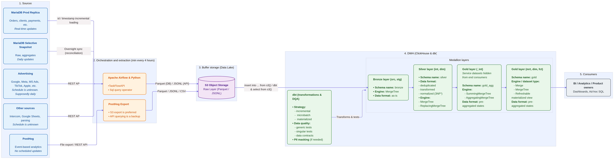

# 1. Выявление требований и уточняющие вопросы для бизнес-стейкхолдеров
##### 1. Свежесть данных, SLA и бизнес-критичность
* **Требования к задержке по уровням:** действительно ли всем 169 *объектам* MariaDB (152 базовые таблицы + 17 представлений) необходима синхронизация каждые 4 часа? Разделение таблиц на уровни приоритета (например, ключевые продуктовые события раз в 4 часа против статичных справочников раз в сутки) позволяет существенно снизить нагрузку на реплику и затраты на вычисления.
* **Real-Time против микробатчей:** существуют ли операционные дашборды, триггеры алертинга или пользовательские фичи, которым требуется задержка менее минуты / near-real-time (что оправдало бы внедрение CDC/Kafka на первом этапе), или 4-часового батч-SLA достаточно для всех текущих аналитических задач?

##### 2. Историческая глубина, обновления и сроки хранения
* **Необходимость SCD2:** для изменяемых таблиц без колонки `updated_at` (таких как `usr_01` объёмом 13.1 ГБ или `mkt_01` объёмом 18.2 ГБ) нужно ли бизнесу отслеживать полную историю изменения состояний во времени, или достаточно только последнего актуального состояния?
* **Политика хранения и архивации:** какое окно исторических данных (lookback window) требуется для аналитики в горячем хранилище ClickHouse (например, 1–2 года для `prd_03` / `prd_05`), и по истечении какого срока старые партиции можно архивировать исключительно в холодное хранилище S3 для оптимизации затрат на NVMe/SSD?

##### 3. Владение источниками и эволюция схем
* **Изменение схем на источнике и возможность добавления `updated_at`:** могут ли бэкенд-разработчики добавить индексируемую колонку/триггер `updated_at` в самые крупные изменяемые таблицы (`mkt_01`, `usr_01`, `prd_03`, `prd_05`) или включить бинарное логирование MariaDB (`binlog_format=ROW`) для будущего CDC? Если нет, каково максимальное ожидаемое окно ретроактивных обновлений (например, изменяются ли записи спустя более чем 7–14 дней после создания)?
* **Семантика удалений:** бывают ли в MariaDB жёсткие удаления строк (например, удаление по GDPR, отмена заказа, удаление пользователя)? Жёсткие удаления невидимы ни для одного high-watermark- или timestamp-инкремента и требуют явного маркера `is_deleted` либо периодической сверки через anti-join.
* **Актуальность таблиц и устаревшие данные:** сколько из 169 объектов реально используются для расчёта бизнес-KPI, а какие являются legacy/устаревшими (представления, стейджинг-пары `pay_ext_*_raw`/`_test`, копии с датой в имени) и могут быть исключены из первоначальной загрузки?

##### 4. Существующие объекты ClickHouse
* **Авторитетные или производные?** У 19 объектов ClickHouse нет пары в MariaDB (`prd_01`, `prd_02`, `prd_04`, `prd_07`, `prd_08`, `prd_10`, `prd_13`, `prd_18`, `prd_19`, `prd_25`, `pay_06`, `pay_07`, `pay_10`, `pay_12`, `pay_13`, `pay_22`, `svc_01`, `ref_04`, `mkt_18`, плюс материализованное представление `prd_42` и представления `v_18`/`v_19`). Кто ими владеет, наполняются ли они приложением в реальном времени, и можно ли перенести/переименовать их в bronze/silver, или текущие имена должны остаться нетронутыми для существующих потребителей?
* **Какой слой сегодня является источником истины** для `prd_07` (`snapshot_date`), `prd_08` (`valid_from`) и `prd_10` (`SummingMergeTree`) — MariaDB, запись из приложения или агрегация на стороне ClickHouse?

##### 5. Безопасность, PII и управление доступом
* **Персональные данные и комплаенс:** какие конкретно колонки в `usr_01` и транзакционных логах содержат персональные данные (email-адреса, IP, имена) и какая политика анонимизации требуется (хеширование, маскирование или ролевое ограничение на уровне колонок) перед передачей данных в BI-инструменты (если это не обрабатывается заранее)? Обратите внимание, что это требование распространяется и на сырой слой S3, где Parquet-файлы хранят полезную нагрузку в открытом виде.
* **Профили потребителей и конкурентность:** кто является основными потребителями слоя gold (соотношение зрителей BI-дашбордов и ad-hoc SQL-аналитиков) и какая пиковая конкурентность запросов ожидается в рабочие часы?

# 2. Схема архитектуры

# 3-4. Извлечение, хранение и надёжность
## 1. Источники данных
### Проверенная инвентаризация источников (по предоставленным выгрузкам таблиц)
| Метрика | Значение |
|---|---|
| Объектов в выгрузке MariaDB | 169 (152 базовые таблицы + 17 представлений `v_01`…`v_17`) |
| Всего строк (базовые таблицы) | ~668.9 млн |
| Суммарный размер на диске | ~217 ГБ |
| Базовых таблиц с `updated_at` | 3 (`mkt_12`, `msg_11`, `svc_06`) — 16 791 / 22 / 0 строк |
| Фактический охват загрузки | ~140 таблиц (~99.9% объёма) |
| Объектов в ClickHouse сегодня | 58 таблиц + 1 материализованное представление + 2 представления |
| Объектов ClickHouse без источника в MariaDB | 19 (+ MV `prd_42`, `v_18`, `v_19`) |

**Исключается из загрузки (подтверждено анализом выгрузки таблиц):**
* **17 представлений** (`v_01`…`v_17`) — не физические данные; при необходимости их логика переписывается как dbt-модель поверх синхронизированных базовых таблиц.
* **Стейджинг / непродакшн-артефакты:** `pay_ext_a_raw`…`pay_ext_e_raw` и `pay_ext_a_test`…`pay_ext_e_test`, а также копии с датой в имени `mkt_meta_01_20260714` и `mkt_mmp_03_bak_20260814` (~780 тыс. строк, ~0.5 ГБ). Требует подтверждения владельца.
* **Пустые таблицы:** `prd_41`, `mkt_mmp_05`, `svc_06` — загружается только схема, строк нет, влияния на пайплайн нет.

##### Prod-реплика MariaDB
**Что:** 152 базовые таблицы (~668.9 млн строк, 217 ГБ), из которых ~140 входят в охват.
**Когда:** инкрементальные запуски каждые 4 часа для ключевых операционных сущностей (`00/04/08/12/16/20 UTC`, то есть 6 запусков в сутки).
* ***Оптимизация:*** данные разделены на уровни (тиры) в зависимости от бизнес-критичности и частоты изменений. Не всем таблицам требуется одинаковая частота синхронизации.

| Уровень | Частота | Таблицы (примеры с реальными размерами) | Доля объёма |
|---|---|---|---|
| **P0 — горячие и изменяемые** | 6 раз/сутки | `prd_03` (148.3 млн / 32.2 ГБ), `prd_05` (67.6 млн / 30.5 ГБ), `usr_01` (56.1 млн / 13.4 ГБ), `prd_06` (37.5 млн / 11.9 ГБ), `msg_01` (33.5 млн / 7.0 ГБ), `pay_01` (28.0 млн / 6.5 ГБ), `pay_02` (28.5 млн / 2.8 ГБ), `mkt_01` (23.8 млн / 18.6 ГБ), `prd_09` (22.4 млн / 12.2 ГБ), `pay_03`–`pay_05`, `msg_02`/`msg_03`, `prd_11`/`prd_12`, `mkt_mmp_01` | ~85% |
| **P1 — тёплые** | ежедневно | `usr_02`–`usr_12`, `prd_14`–`prd_17`, `anl_01`–`anl_06`, остальные `mkt_*` / `mkt_*_01`, `pay_06`–`pay_11`, `msg_04`+ | ~15% |
| **P2 — справочники и хвост** | ежедневно, полная перезапись | `ref_*`, `svc_*`, `usr_13`–`usr_16`, `prd_20`+, `mkt_12`+, `pay_12`+ (все < 500 тыс. строк) | < 1% |

*Примечание:* `prd_05` (67.6 млн строк / 30.5 ГБ) и `prd_09` (22.4 млн / 12.2 ГБ) — крупнейшие таблицы, у которых **сегодня нет пары в ClickHouse**, то есть это загрузка с нуля, а не миграция.

**Как:**
* ***Проблема:*** в 149 из 152 базовых таблиц (98%) полностью отсутствует колонка `updated_at`, и, что критично, **ни в одной из 20 крупнейших таблиц её нет**. Если существующая запись (например, профиль пользователя в `usr_01`) обновляется на месте, её первичный ключ (`id`) и время создания остаются неизменными. Стандартный high-watermark-запрос (`WHERE id > :last_max_id`) полностью пропустит такое обновление.
* ***Дешёвый вариант (если отсутствие мутаций гарантировано):*** для append-only логов событий используется стандартная high-watermark-пагинация по `id` или дате события. Для изменяемых таблиц сущностей без `updated_at` мы полагаемся на скользящие окна по партициям/диапазонам дат (периодическая перезаливка активных партиций, например за последние 3–7 дней) в сочетании с дедупликацией на записи в слое Silver.
* ***Сверка для P0-изменяемых таблиц (обязательно):*** крупные изменяемые сущности (`prd_03`, `prd_05`, `usr_01`, `mkt_01`) невозможно покрыть только 7-дневным окном, поскольку обновления регулярно приходят спустя недели после создания записи. Еженедельное сравнение контрольных сумм по диапазонам `id` (`CHECKSUM TABLE` по диапазону или `SUM(CRC32(CONCAT_WS(...)))` по срезам в 1 млн строк PK) с последним известным снапшотом даёт список изменившихся диапазонов, которые затем перевыгружаются и перезаписываются на уровне партиций. Полное сканирование таблицы не требуется ни на одной из сторон.
* ***Механика извлечения:*** каждая задача сначала проверяет здоровье реплики (`SHOW REPLICA STATUS` → `Seconds_Behind_Source` ниже порога, поток репликации активен) и прерывается без записи, если реплика отстаёт. Чтение выполняется чанками по диапазонам первичного ключа (ограниченные `WHERE id BETWEEN …`, без долгоживущих транзакций), в семантике `--single-transaction` и с троттлингом, чтобы извлечение никогда не насыщало реплику.
* ***Обработка удалений:*** жёсткие удаления необнаружимы через high-watermark. Bronze хранит append-only историю; Silver восстанавливает актуальное состояние через маркер `ReplacingMergeTree(is_deleted)` или периодический anti-join к реплике для P0-таблиц, чтобы удалённые сущности исчезали из витрин gold.
* ***Дорогой вариант (100% захват изменений):*** CDC + Kafka путём чтения бинарного лога MariaDB (binlog), когда будет включён `binlog_format=ROW` — стратегическая цель для P0-таблиц.
* ***Дрейф схемы:*** каждый запуск сохраняет снимок `INFORMATION_SCHEMA.COLUMNS` по извлекаемым таблицам в S3 (`_schema/{table}/{run}.json`) и сравнивает его с предыдущим снимком. Добавленные/переименованные/удалённые колонки громко валят задачу, вместо того чтобы молча сдвигать вывод `SELECT *`.
 

##### Нативные источники ClickHouse
**Что:** 19 таблиц, а также MV `prd_42` и представления `v_18`/`v_19`, которые существуют только в ClickHouse.
**Когда:** в Фазе 1 остаются как есть; в Фазе 2 унифицируются в пространство имён bronze.
**Как:**
* `prd_01` (693.6 млн строк) и `prd_02` (289.3 млн строк) — высокообъёмные внутренние логи; они остаются нативными и становятся bronze-смежными источниками, с TTL для переноса холодных партиций в S3.
* `prd_07` (`snapshot_date`), `prd_08` (`valid_from`) и `prd_10` (`SummingMergeTree`) уже реализуют паттерны SCD2 и предагрегации, описанные ниже. Новый пайплайн **переиспользует эти соглашения и существующие имена таблиц**, а не выводит их заново, и эти таблицы не переименовываются без явного согласования с потребителями.
 

##### Рекламные API
**Что:** маркетинговые расходы, показы, клики и метрики конверсий.
**Когда:** каждые 4 часа.
**Как:**
* ***API-курсоры и инкрементальная синхронизация:*** использование нативных параметров пагинации API, дельта-токенов или фильтров по дате (`updated_from >= :last_sync_timestamp`), если они поддерживаются источником.
* ***Обработка окна атрибуции:*** поскольку конверсии могут прилетать спустя дни после клика, пайплайн забирает скользящее окно ретроспективы за последние 7 дней. Вместо дорогостоящего построчного сравнения хешей в Python новые срезы просто перезаписывают соответствующие дневные/часовые партиции в ClickHouse, обеспечивая идемпотентность и чистоту данных без нагрузки на CPU.
 

##### PostHog
**Что:** сырые события продуктовой телеметрии.
**Когда:** каждые 1–4 часа.
**Как:**
* ***Пакетный экспорт PostHog в S3:*** сервис на своей стороне упаковывает события в файлы Parquet/JSONL и асинхронно стримит их напрямую в наш S3-бакет.
* ***Резервный API:*** REST API PostHog зарезервирован исключительно как бэкап или для точечных запросов по требованию, что позволяет избежать тяжёлого стриминга событий по HTTP.
 

##### Другие источники
**Что:** операционные таблицы и выгрузки из сторонних CRM.
**Когда:** каждые 4 часа.
**Как:** легковесные скрипты в Airflow, выполняющие полную перезапись для небольших справочных датасетов, чтобы пайплайны оставались простыми и удобными в поддержке.
 

##### *Дополнительная рекомендация
**Что:** тяжёлые системные логи ClickHouse.
**Когда:** не применимо.
**Как:** настройка TTL или перенос старых логов в холодное хранилище S3 позволит сэкономить высокопроизводительные SSD-диски и бюджет.

## 2. Оркестрация и надёжность (Apache Airflow)
**Что:** централизованная оркестрация рабочих процессов с использованием Apache Airflow, управляющая выполнением DAG-ов, зависимостями задач и расписаниями во всех пайплайнах загрузки и трансформации.
**Как:**
* ***Идемпотентность:*** каждый запуск записывает неизменяемый файл Parquet/JSONL, названный в соответствии с его плановым интервалом, внутри S3-пути с партиционированием по дате (например, `s3://dwh-datalake/raw/{source}/{table}/date={{ ds }}/batch_{{ data_interval_start.strftime('%H%M') }}.parquet`). Поскольку `data_interval_start` не меняется при повторных попытках задачи, перезапуск упавшей джобы безопасно перезаписывает ровно тот же целевой файл без создания дубликатов и расхождения данных.
* ***Повторные попытки и экспоненциальная задержка:*** задачи настроены с автоматическими повторами (например, `retries=3`, `retry_delay=5 минут` с экспоненциальной задержкой) для корректной обработки временных сетевых сбоев, лимитов API или кратковременных обрывов соединения с репликой MariaDB.
* ***Проверки реплики и источника:*** задача `check_source_health` выполняется перед извлечением и валит запуск, если отставание реплики превышает порог, позиция binlog устарела или внешний API вернул ошибку квоты — это предотвращает попадание в стейджинг частичных/битых батчей.
* ***Контроль качества данных и алерты по объёмам:*** автоматические проверки (через dbt-тесты и кастомные Python-операторы). Если свежезагруженный батч содержит 0 строк или количество строк падает более чем на 50% по сравнению со средним историческим значением за неделю, пайплайн падает и немедленно отправляет алерт.
* ***Алертинг и управление инцидентами:*** критические сбои пайплайнов и нарушения SLA отправляют автоматические уведомления в Telegram/Slack-канал команды Data Engineering через Airflow `on_failure_callback`, содержащие DAG ID, имя задачи и логи ошибок для быстрого траблшутинга.
* ***Бэкфиллы:*** поскольку S3 — единственная зависимость на чтение при пересчёте, бэкфилл выражается как `INSERT INTO bronze.{table} SELECT … FROM s3(…)` по явному интервалу, а не как повторный запрос к продакшн-источникам.

## 3. Буферное хранилище и повторная загрузка
**Что:** промежуточный неизменяемый слой Data Lake, построенный поверх S3-совместимого объектного хранилища. Он хранит сырые извлечённые данные «как есть» в структурированных партиционированных путях (`s3://dwh-datalake/raw/{source}/{table}/date={{ ds }}/`).
**Зачем:**
* ***Изоляция продакшн-систем:*** прямые аналитические запросы или тяжёлые задачи выгрузки из ClickHouse к реплике MariaDB или внешним API могут серьёзно снизить производительность источников или упереться в лимиты запросов. S3 выступает надёжным буфером, который полностью отделяет извлечение данных от последующих трансформаций.
* ***Оптимизация форматов данных:*** сырые данные из API и транзакционных дампов конвертируются в формат Parquet во время загрузки. Parquet обеспечивает эффективное колоночное сжатие и высокую скорость аналитического чтения для ClickHouse (через табличный движок `s3()`).
* ***Открытые табличные форматы и расширяемость:*** структурируя сырые данные в S3, мы получаем архитектурную гибкость для наложения поверх них табличных форматов вроде Apache Iceberg или Delta Lake в будущем. Это позволяет независимым вычислительным движкам (таким как Spark, Trino или DuckDB) обращаться напрямую к стейджинг-слою без привязки стека к одному вендору баз данных.

**Как:**
* ***Неизменяемое хранилище для повторной обработки:*** если в нижестоящей dbt-модели обнаружен баг или таблицы ClickHouse нужно пересобрать с нуля, инженерам не требуется повторно опрашивать продакшн-реплику MariaDB или внешние API.
* ***Детерминированная повторная загрузка из S3:*** Airflow запускает чистый перезапуск, считывая исторические Parquet-файлы напрямую из S3 в слои Bronze/Silver. Это гарантирует нулевую нагрузку на продакшн во время отладки, дозагрузки исторических данных или эволюции схем.
* ***Управление сырым слоем:*** сырая зона содержит PII в открытом виде, поэтому контроли на уровне бакета являются частью дизайна, а не дополнением — шифрование SSE-KMS, заблокированный публичный доступ, версионирование бакета, write-only доступ для ролей загрузки и доступ на чтение только через роль ClickHouse, плюс политика жизненного цикла (Standard → IA через 30 дней → Glacier IR через 180 дней), чтобы возможность воспроизведения сохранялась при ограниченных затратах.

## 4. Хранилище данных и трансформации
**Что:** трёхуровневая архитектура Medallion (Bronze → Silver → Gold) на ClickHouse, с оркестрацией и трансформациями через dbt.
**Как**:
* ***Слой Bronze (сырая загрузка):***
    * *Назначение:* точная, невалидированная посадочная зона для сырых данных, загружаемых из Parquet-файлов в S3 (через табличные функции ClickHouse `s3()` или `S3Queue`), а также для внутренних логов ClickHouse в реальном времени (`prd_01`, `prd_02`).
    * *Движок хранения:* MergeTree (append-only) с партиционированием по месяцу загрузки/события (`PARTITION BY toYYYYMM(dt)`), что обеспечивает быструю запись и изолированное управление партициями.

* ***Слой Silver (очистка, типизация и дедупликация):***
    * *Назначение:* стандартизированные схемы, явные типы данных, нормализация часовых поясов (UTC) и дедупликация сущностей.
    * *Дедупликация решается на записи, а не на чтении:* ReplacingMergeTree сворачивает дубликаты **только во время фоновых слияний** — запрос, выполненный до слияния (и любой потребитель, не указавший `FINAL`), спокойно прочитает дубликаты. Именно этот дефект виден в текущем хранилище, где несколько таблиц с `ReplacingMergeTree ORDER BY id` содержат больше строк, чем их источник в MariaDB (`mkt_03` +651%, `msg_01` +82%, `mkt_02` +41%, `usr_01` +8%, и, наоборот, `usr_03` −2%). Поэтому каждая инкрементальная модель Silver пишет **детерминированный результат «одна строка на ключ»** средствами самого ClickHouse — `argMax(col, version) GROUP BY id` или `LIMIT 1 BY id` внутри модели — и применяет `insert_overwrite` по затронутым партициям. Тогда нижестоящим запросам не нужны ни `FINAL`, ни удачное расписание слияний, а `ReplacingMergeTree(version_col)` остаётся лишь страховкой от поздно пришедших дубликатов.
    * *Отслеживание истории:* чтобы закрыть требования по историческому анализу на конкретный момент времени (например, отслеживание смены тарифов пользователя или переходов между статусами), SCD2 выводится из append-only истории Bronze по тем же соглашениям `valid_from`/`valid_to`, что уже используются в существующей таблице `prd_08`. Нативный `dbt snapshot` оставлен только для узких измерений (существенно меньше 5 млн строк), поскольку снапшот по сущности в 50+ млн строк пересканирует всю таблицу на каждом запуске.

* ***Слой Gold (внутренние предагрегации):***
    * *Назначение:* скрытый сервисный слой, хранящий промежуточные предагрегированные состояния (`SummingMergeTree`, `AggregatingMergeTree`, отдельные таблицы на движке `Merge`) — расширение паттерна, уже присутствующего в `prd_10`.
    * *Изоляция и безопасность:* намеренно скрыт от конечных потребителей и BI-инструментов через RBAC. Прямая работа с колонками состояний `AggregatingMergeTree` (`AggregateFunction`) требует специфического синтаксиса ClickHouse (комбинаторы `-State` / `-Merge`) и глубокого понимания механики фоновых слияний. Изоляция этих датасетов в `gold_agg` не позволяет нетехническим пользователям и аналитикам обращаться к сырым промежуточным состояниям и некорректно интерпретировать несмерженные метрики.

* ***Слой Gold (бизнес-витрины)***:
    * *Назначение:* клиентский аналитический слой, содержащий чистые таблицы измерений (dim) и фактов (fct) в схеме «звезда», а также широкие бизнес-витрины (mrt), готовые для BI-инструментов и ad-hoc запросов.
    * *Движки и материализация:* построены на стандартном MergeTree, движке таблиц Merge (для бесшовного объединения шардированных или исторических таблиц) и обновляемых материализованных представлениях (Refreshable Materialized Views), обеспечивая чистые, финализированные и человекочитаемые типы данных с субсекундной скоростью выполнения запросов.
    * *Именование и миграция:* существующие потребители ClickHouse сохраняют имена таблиц до явного переключения; новые объекты `mrt_*`/`dim_*`/`fct_*` вводятся параллельно и включаются по одному отчёту, чтобы определения `prd_42`/`v_18`/`v_19` можно было пересобрать без ломающего изменения.

## 5. Потребители данных и слой витрин
**Что:** нижестоящий слой потребления, где BI-инструменты, аналитики и автоматизированные сервисы запрашивают финализированные датасеты строго из схемы gold.
**Ключевые интерфейсы потребителей и паттерны обслуживания:**
* ***BI и self-service аналитика:***
    * *Назначение:* автоматизированные управленческие дашборды, продуктовые воронки и отчёты по маркетинговой атрибуции.
    * *Оптимизация выдачи:* BI-инструменты подключаются исключительно к заранее смоделированным витринам gold. Поскольку тяжёлые джойны и агрегации уже выполнены выше по потоку в dbt, запросы дашбордов отрабатывают с субсекундной задержкой, не нагружая CPU/RAM ClickHouse.
* ***Ad-hoc SQL-исследования:***
    * *Назначение:* глубокие когортные исследования, оценка A/B-тестов и кастомный анализ фич.
    * *Ограничения и квоты ресурсов:* аналитики обращаются к gold через выделенные read-only профили ClickHouse (`readonly = 1`) с жёсткими лимитами ресурсов (`max_memory_usage`, `max_execution_time`, `max_concurrent_queries_for_user`). При этом bronze, silver и gold_agg остаются без выданных прав, поэтому случайный запрос к сырым логам или несмерженным состояниям `AggregateFunction` завершается ошибкой доступа, а не молча возвращает неверные числа.
* ***Reverse ETL и нижестоящие интеграции***:
    * *Назначение:* передача рассчитанных пользовательских сегментов, скоринга оттока или статусов подписок обратно в CRM/маркетинговые платформы или продуктовые сервисы.
    * *Реализация:* запланированные экспорты Airflow/dbt считывают финализированные срезы из витрин gold и отправляют обновления через API или экспорт в S3, изолируя операционные базы данных от аналитических нагрузок.
* ***SLA для потребителей и контракты данных (Data Contracts):***
    * *Назначение:* обеспечение предсказуемой доступности данных и чётких ожиданий для бизнес-пользователей.
    * *Гарантия свежести:* конечные потребители полагаются на предсказуемую свежесть данных, согласованную с 4-часовым циклом синхронизации MariaDB (6 запусков в сутки) и ежедневными маркетинговыми сводками, что подкрепляется проверками `dbt source freshness` и автоматическими алертами в Slack/Telegram, если задержка на источнике влияет на доступность таблиц gold.
* ***Интегрированный слой метаданных dbt и портал документации***
    * *Назначение:* обеспечивает бизнес-аналитиков и потребителей данных возможностью самостоятельного поиска, предоставляя прозрачные определения метрик и схем таблиц без бутылочных горлышек в виде инженеров.
    * *Слой метаданных:* фиксация явных описаний колонок, владельцев данных и определений бизнес-логики непосредственно в `.yml` конфигурационных файлах dbt рядом с кодом трансформаций.
    * *Нативная документация:* публикация интерактивного веб-каталога через `dbt docs generate`, привязанного к CI/CD-пайплайнам, что даёт потребителям мгновенную видимость происхождения данных и их свежести перед выполнением запросов к слою gold.

# 5. Администрирование, управление данными и планирование
##### Контроль доступа и изоляция схем (RBAC)
**Что:** строгий ролевой доступ (RBAC) на уровне базы данных, обеспечивающий разделение пространств имён между bronze, silver, gold_agg и gold.
**Зачем:** предотвращает случайные запросы бизнес-аналитиков и BI-инструментов к сырым логам загрузки (bronze) или несмерженным состояниям `AggregateFunction` (gold_agg), исключая ошибки в расчёте метрик и тяжёлые неоптимизированные полные сканирования таблиц.
**Как:**
* Выдать права на чтение только на клиентскую схему gold (`GRANT SELECT ON gold.*`) для сервисных учётных записей BI и аналитиков.
* Не выдавать никаких прав на bronze, silver и gold_agg для неинженерных ролей. Учтите, что ClickHouse не может скрыть от пользователя *имена* баз данных — только их содержимое, поэтому изоляция обеспечивается гранулярными правами и профилями `readonly = 1/2`, а не ожиданием, что схемы будут невидимы.
* Установить профили ресурсов на запросы (`max_memory_usage`, `max_execution_time`, `max_concurrent_queries_for_user`) для ad-hoc пользователей, чтобы изолировать продакшн-пайплайны dbt от всплесков пользовательских запросов.
 

##### Анонимизация персональных данных и приватность
**Что:** автоматическое хеширование и маскирование PII перед передачей в аналитический слой, а также контролируемый доступ к сырому слою, где PII всё ещё присутствует в открытом виде.
**Зачем:** обеспечивает соответствие требованиям регуляторов по защите данных и защищает чувствительные идентификаторы пользователей, извлечённые из операционных таблиц, от несанкционированного раскрытия в нижестоящих BI-инструментах.
**Как:**
* Выявлять поля с PII (email-адреса, IP-адреса, номера телефонов) на этапе маппинга при загрузке и фиксировать их в поддерживаемом реестре PII-колонок.
* Применять детерминированное соление (salting) и хеширование SHA-256 (или маскирование на уровне колонок) внутри dbt-трансформаций на шаге Bronze $\rightarrow$ Silver, гарантируя, что сырые PII никогда не попадут в слой gold, при этом сохраняя возможность объединять записи по пользовательским сущностям.
* Поскольку сырая зона S3 неизбежно содержит незамаскированные данные, она защищается отдельно: шифрование SSE-KMS, отсутствие публичного доступа, учётные данные только на запись для загрузки, учётные данные только на чтение для ClickHouse и аудируемый след доступа.
 

##### Аварийное восстановление и стратегия резервного копирования (S3-First подход)
**Что:** воспроизводимое восстановление хранилища без сохранения состояния (stateless), опирающееся на неизменяемый S3-стейджинг и декларативный код dbt вместо традиционных снапшотов баз данных.
**Зачем:** традиционные файловые бэкапы ClickHouse (`clickhouse-backup`) для многотерабайтных таблиц раздувают объём хранения, создают сетевую нагрузку и усложняют эксплуатацию без реальной пользы, когда сырые данные уже надёжно сохранены.
**Как:**
* Все сырые выгрузки из MariaDB, маркетинговых API и PostHog хранятся в виде неизменяемых Parquet-файлов в S3 с включённым версионированием бакетов и политиками жизненного цикла.
* Поскольку все трансформации Silver, gold_agg и Gold версионируются в dbt, любая повреждённая таблица или вышедшая из строя нода ClickHouse может быть чисто пересобрана с нуля путём перезапуска инкрементальных моделей dbt поверх S3.
* Легковесные автоматические бэкапы поддерживаются исключительно для базы метаданных Airflow, артефактов dbt и DDL-схем/конфигураций ClickHouse.
* **Целевые показатели:** RPO 24 ч для таблиц P1/P2 и 4 ч для P0 (ограничено частотой стейджинга в S3); RTO 1 рабочий день на полную пересборку silver/gold для P0-витрин, с ежеквартальной учебной проверкой восстановления, а не предположением о ней.
 

##### Наблюдаемость
**Что:** непрерывный мониторинг здоровья хранилища наряду со здоровьем пайплайнов.
**Как:**
* Внутренние метрики ClickHouse: `system.parts` (количество партиций, рост партов, неактивные парты), `system.merges`, `system.query_log` (медленные запросы, пики памяти), `system.asynchronous_metrics`.
* Пайплайн: дашборды по количеству строк и свежести в разрезе таблиц с алертингом при отклонении сверх настраиваемого порога — именно это позволило бы поймать существующие расхождения в количестве строк между ClickHouse и MariaDB.
 

##### План внедрения (первые 1–2 месяца — Фаза 1 MVP)
**Недели 1–2 — инфраструктура, S3-стейджинг и слой Bronze:**
* Развернуть S3-бакеты (с KMS и политиками жизненного цикла) и Apache Airflow.
* Построить идемпотентные DAG-и извлечения в Airflow для ~140 входящих в охват таблиц MariaDB, начиная с уровня P0 (`prd_03`, `prd_05`, `usr_01`, `mkt_01`, `prd_06`, `pay_01`–`pay_05`, `msg_01`–`msg_03`), исключая 17 представлений, стейджинг-пары `pay_ext_*` и копии с датой в имени.
* Развернуть append-only таблицы MergeTree в слое Bronze с партиционированием по месяцам (`toYYYYMM(dt)`).
* Добавить `check_source_health`, чанкование по диапазонам PK и снимок дрейфа схемы из `INFORMATION_SCHEMA` с первого дня.

**Недели 3–4 — интеграция dbt и слой Silver:**
* Настроить структуру проекта dbt-clickhouse и CI/CD-пайплайны.
* Реализовать инкрементальные модели Silver с `insert_overwrite`, перезагрузкой скользящим окном и детерминированной дедупликацией на записи (`argMax` / `LIMIT 1 BY id`), чтобы ни один потребитель не зависел от `FINAL`.
* Реализовать еженедельную сверку контрольных сумм по диапазонам PK для четырёх крупнейших изменяемых таблиц.
* Настроить паттерн SCD2 `valid_from`/`valid_to`, выводимый из Bronze, для критичных сущностей; `dbt snapshot` использовать только для узких измерений. Настроить базовые dbt-тесты (unique, not_null).

**Недели 5–6 — витрины Gold, предагрегации и RBAC:**
* Построить ключевые измерения и факты по схеме «звезда» и бизнес-витрины в схеме gold (плюс внутренние роллапы gold_agg, где это необходимо).
* Применить профили ClickHouse RBAC, правила маскирования PII и подключить BI-инструменты (Superset / Metabase).

**Недели 7–8 — наблюдаемость, алертинг и передача в продакшн:**
* Включить мониторинг свежести источников (`dbt source freshness`), интегрированный с алертами в Slack/Telegram на случай задержек загрузки на источниках.
* Провести мониторинг системных таблиц ClickHouse (`system.query_log`, `system.parts`) под реальной конкурентной нагрузкой BI и выполнить тюнинг порогов памяти и слияний.
* Финализировать документацию каталога данных и провести онбординг аналитиков.

# Приложение A. Проверка инвентаризации и находки по качеству данных
Цифры, приведённые выше, пересчитаны напрямую по предоставленным выгрузкам таблиц.

**Подтверждено:** 169 объектов = 152 базовые таблицы + 17 представлений; 668 946 354 строки; 217 137 МБ (~217 ГБ); `usr_01` 13 437 МБ и `mkt_01` 18 629 МБ, как указано в разделе 1; `prd_01`/`prd_02` существуют только в ClickHouse; все утверждения про `partition_by`/`order_by`/движки соответствуют реальной схеме.

**Поправка к утверждению из раннего черновика:** колонка `updated_at` есть только в 3 из 152 базовых таблиц (149/152 = 98%), а не «166 из 169» — и все три крошечные (`mkt_12` 16 791 строка, `msg_11` 22, `svc_06` 0). **Ни в одной из 20 крупнейших таблиц `updated_at` нет**, и именно этот факт является определяющим для стратегии инкрементальной загрузки.

**Расхождения между текущими таблицами ClickHouse и их источниками в MariaDB** (одна и та же логическая сущность, `ReplacingMergeTree ORDER BY id`):

| Таблица | Строк в MariaDB | Строк в ClickHouse | Дельта |
|---|---|---|---|
| `mkt_03` | 416 156 | 3 126 471 | **+651%** |
| `msg_01` | 33 521 311 | 60 874 967 | **+81.6%** |
| `mkt_02` | 3 547 715 | 5 013 820 | **+41.3%** |
| `mkt_14` | 1 236 | 1 391 | +12.5% |
| `usr_01` | 56 088 100 | 60 485 374 | +7.8% |
| `prd_03` | 148 253 978 | 153 327 251 | +3.4% |
| `usr_03` | 4 901 033 | 4 801 185 | **−2.0%** |

Положительные дельты по `ReplacingMergeTree` с уникальным ключом означают, что текущий путь загрузки создаёт дубликаты, которые слияния не свернули (и их прочитает любой запрос без `FINAL`); отрицательная дельта по `usr_03` указывает на пропущенные строки или жёсткие удаления на источнике. И то и другое решается шагами дедупликации на записи и сверки, описанными в разделе 3-4.4.

**Ошибка в инвентаризации:** `pay_23` содержит 32 строки в обеих системах, но помечена как `also_in_mariadb_replica = no`; флаг должен быть `yes`. `prd_42` — это MaterializedView, а `v_18`/`v_19` — представления; их определения необходимо пересобрать после любого перемещения базовых таблиц.
